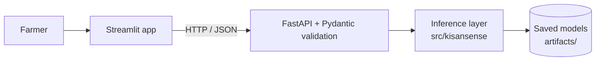

# KisanSense

Decision support for farmers, in one app: **check a tomato leaf for disease**, **get crop suggestions from soil and weather**, and **see where Karnataka tomato prices are heading**.

Built end to end: data audit → leakage-aware evaluation → trained models → FastAPI backend → Streamlit app → 46 automated tests.


| Crop advisor | Price explorer |
|---|---|
|  |  |

> **Not agricultural or financial advice.** This is an experimental project trained on public datasets. Read the [limitations](#limitations) before trusting any number here.

## Modules and measured results

All numbers below are measured, not estimated. Full detail is in `docs/results/*.json`.

### 1. Tomato leaf disease detection (deep learning)
6 classes from PlantVillage (5 diseases + healthy), 9,350 images, split 60/20/20 so that duplicate images never cross splits (perceptual hashing + grouped stratified split). The model was picked on validation macro-F1, and the test set was used once for reporting.

| Model | Test accuracy | Test macro-F1 |
|---|---|---|
| Small CNN (baseline, from scratch) | 82.6% | 0.825 |
| **MobileNetV2, transfer learning + fine-tuning** | **93.5%** | **0.930** |

Weakest class: Early blight (F1 0.847, also the least-represented class with 1,000 images). Strongest: healthy (0.989). The app shows a Grad-CAM heatmap with every prediction and says "not sure" when confidence is below 60%.

### 2. Crop recommendation (classical ML)
Logistic Regression vs Random Forest vs HistGradientBoosting, compared with stratified 5-fold cross-validation. Random Forest was selected: **CV macro-F1 0.994, held-out test 0.993**.
This dataset is very clean and well separated, so these scores say little about real-world performance. See limitations.

### 3. Karnataka tomato price forecast (time series)
Daily Karnataka-wide modal price, 7-day horizon. Evaluated with a **rolling-origin backtest** (train on the past only, forecast 7 days, step forward a week), never a random split. Compared against naive, seasonal-naive and 7-day moving-average baselines.
- ARIMA and a lag-feature gradient-boosting model both beat the naive baseline, by roughly **8–9% lower MAE**. Test MAPE is around 16%.
- The 10–90% interval is built from past forecast errors. On the test period it covered **75%** of outcomes versus the 80% intended, so the band is slightly optimistic.
- The app only shows a "rising/falling" signal when the expected move is larger than the model's typical error. Otherwise it says "no clear trend".

## Architecture



- **Frontend**: Streamlit multipage app (`app/`)
- **Backend**: FastAPI, versioned routes under `/api/v1/` (`crop`, `disease`, `price`, `metrics`), input ranges enforced by Pydantic, HTTP 503 if a model file is missing, image uploads limited to JPEG/PNG under 5 MB
- **ML library**: `src/kisansense/` with training, evaluation and prediction code per module
- **Tests**: 46 tests (model logic, API contract, Streamlit pages)

## Run it

```bash
python -m venv .venv
source .venv/bin/activate              # Windows Git Bash: source .venv/Scripts/activate
pip install -r requirements.txt
```

Trained models are not committed (they are in `.gitignore`), so create them first:

```bash
python scripts/check_datasets.py       # verify datasets are in data/raw/
python scripts/train_crop.py           # → artifacts/crop_model.joblib
python scripts/train_price.py          # → artifacts/price_model.joblib
```
For disease, train on a free Colab GPU with `notebooks/disease_training_colab.ipynb` and copy `disease_model.keras` and `disease_classes.json` into `artifacts/`.

Datasets and where they go are described in [`data/README.md`](data/README.md).

Then start both servers from the project root:

```bash
uvicorn backend.app.main:app --reload      # API docs at http://127.0.0.1:8000/docs
streamlit run app/Home.py                  # app at http://localhost:8501
python -m pytest -q tests                  # 46 tests
```

## Project layout
```
app/             Streamlit frontend (Home + 3 pages)
backend/app/     FastAPI app, schemas, routers
src/kisansense/  ML code: common, crop, disease, price
scripts/         dataset check, training entry points
notebooks/       Colab notebook for disease training
tests/           pytest suite
docs/            results (metrics, plots) and screenshots
data/ artifacts/ not committed
```

## Limitations
- **Disease images are lab photos.** PlantVillage leaves are photographed on plain backgrounds. Accuracy on real field photos will be lower, and I have not measured it. Duplicate-aware splitting removes exact and near-exact copies, but photos of the same leaf from different angles may still sit in both train and test, so 93.5% can be somewhat optimistic.
- **Crop data has no location.** The crop dataset is clean and highly separable and has no region column, so its scores do not show how it would do on a real farm. It can't say which crops suit a given district.
- **Prices are Karnataka-wide, not a single mandi.** Gaps in the daily series were filled by interpolation, and those days are excluded from the error metrics. Forecasts are rough (around 10–16% typical error) and cover tomato only.
- **No agronomist or economist has reviewed the outputs.** Treat every result as a hint, not a decision.

## Roadmap
SHAP explanations for crop recommendation · yield prediction · natural-language query routing · Docker and CI · cloud deployment
